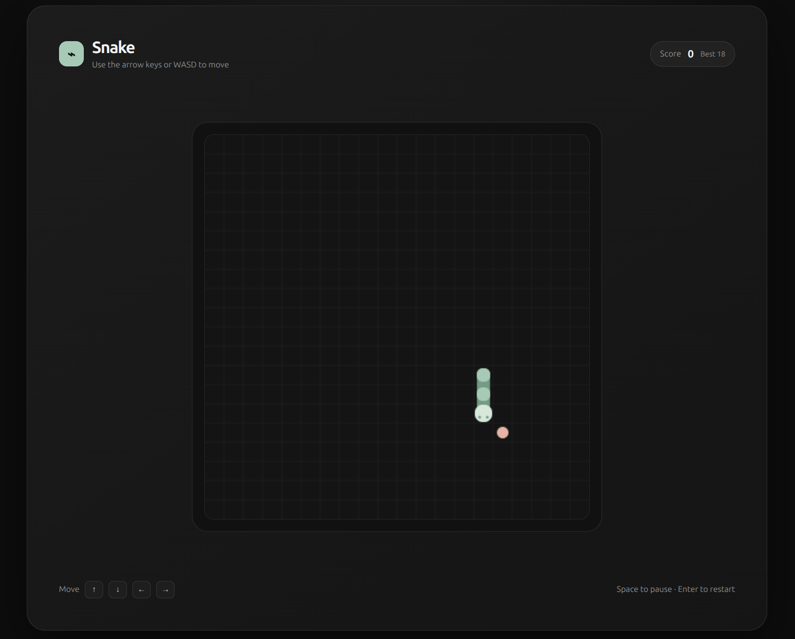
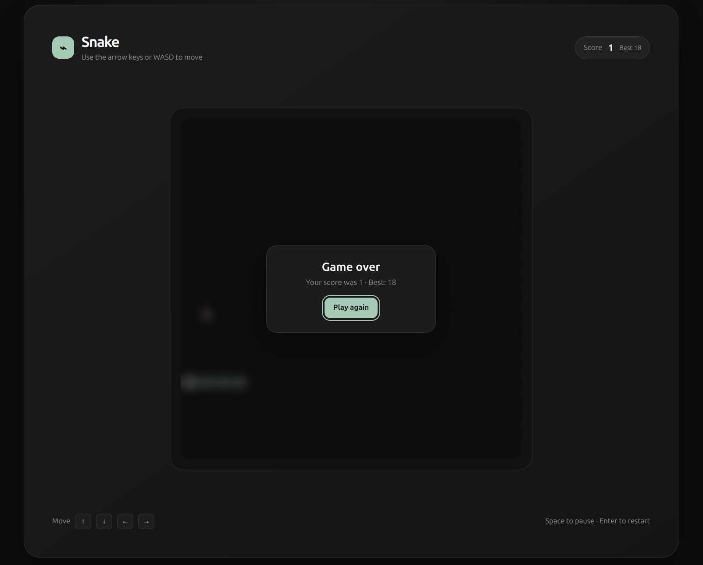
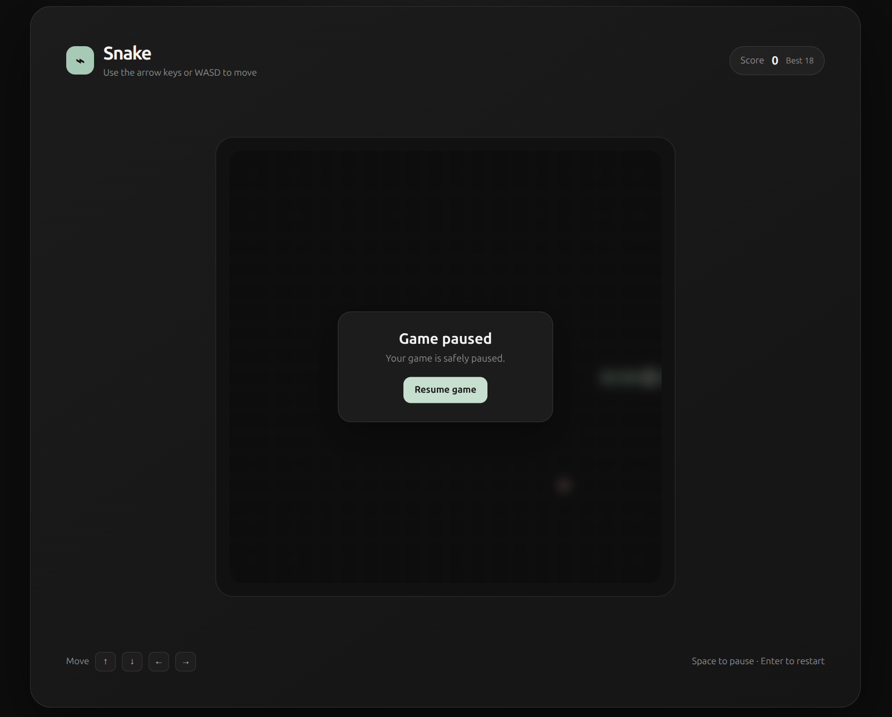

# Snake Game

A responsive browser-based Snake game built with plain HTML, CSS, and JavaScript. The game has a dark, rounded interface, progressive difficulty, pause and restart controls, and a persistent high score.

## Features

- Snake movement with arrow keys or `W`, `A`, `S`, and `D`
- Food collection and snake growth
- Collision detection against the walls and the snake's own body
- Score tracking
- High score saved with `localStorage`
- Progressive speed increase as the score rises
- Progressive visual color changes at higher difficulty levels
- Pause and resume using the Space bar
- Pause overlay with a Resume button
- Game-over overlay with a Play again button
- Restart with the Enter key after game over
- Responsive layout for desktop and mobile screens
- No frameworks, build tools, or external dependencies

## Project structure

```text
.
├── index.html   # Page structure and game interface
├── style.css    # Layout, responsive styling, and overlays
├── script.js    # Game state, rendering, controls, and progression
└── README.md    # Project documentation
```

## Getting started

### Option 1: Open directly in a browser

Open [index.html](./index.html) in a modern browser.

### Option 2: Run a local server

Running a local server is recommended because it more closely matches how the game will be hosted.

With Python installed:

```bash
python3 -m http.server 8000
```

Then open:

```text
http://localhost:8000
```

Stop the server with `Ctrl+C`.

## How to play

### Movement

Use any of these controls:

| Action | Keys |
|---|---|
| Move up | `ArrowUp` or `W` |
| Move down | `ArrowDown` or `S` |
| Move left | `ArrowLeft` or `A` |
| Move right | `ArrowRight` or `D` |

The snake cannot immediately reverse into itself. For example, while moving right, pressing left is ignored until the snake changes direction.

### Pause and resume

Press the Space bar to pause or resume the game. A pause card appears over the board while the game is stopped. You can resume by:

- Pressing Space again
- Clicking the **Resume game** button

### Restart

The game can be restarted by:

- Clicking **Play again** on the game-over card
- Pressing Enter after game over
- Reloading the page

Restarting resets the current score and snake position but does not erase the saved high score.

## Difficulty progression

### Speed

The game becomes faster every three points:

| Score | Movement interval |
|---:|---:|
| 0–2 | 150 ms |
| 3–5 | 138 ms |
| 6–8 | 126 ms |
| 9–11 | 114 ms |
| 12–14 | 102 ms |
| 15–17 | 90 ms |
| 18–20 | 78 ms |
| 21 and above | 60 ms minimum |

The interval is the time between automatic movement steps. A lower value means faster movement.

### Visual difficulty

The snake and food colors change at these score thresholds:

| Score | Visual level |
|---:|---|
| 0–9 | Base palette |
| 10–14 | Level 1 |
| 15–19 | Level 2 |
| 20–24 | Level 3 |
| 25 and above | Maximum visual level |

The colors become progressively deeper while remaining within a calm, muted palette.

## High score

The best score is stored in the browser using:

```javascript
localStorage
```

The storage key is:

```text
snake-high-score
```

The high score is specific to the browser and device profile. It may be cleared when browser site data is removed or when private browsing data is discarded.

To clear the saved high score manually, run this in the browser developer console while the game page is open:

```javascript
localStorage.removeItem("snake-high-score");
```

## Customization

### Change the starting speed

In [script.js](./script.js), update:

```javascript
const startingSpeed = 150;
```

### Change speed progression

These constants control how often the game speeds up and how much faster it becomes:

```javascript
const speedStep = 3;
const speedDecrease = 12;
const minimumSpeed = 60;
```

- `speedStep`: number of points between speed increases
- `speedDecrease`: milliseconds removed at each speed level
- `minimumSpeed`: fastest allowed movement interval

### Change visual thresholds

Update this array in [script.js](./script.js):

```javascript
const difficultyThresholds = [10, 15, 20, 25];
```

### Change game colors

The color palettes are defined in the `difficultyColors` array in [script.js](./script.js). The main interface colors are defined as CSS variables near the top of [style.css](./style.css).

## Game rules

1. The snake starts with three segments.
2. Eating food increases the score by one and grows the snake.
3. Food is placed on a free grid cell.
4. Hitting a wall ends the game.
5. Hitting the snake's own body ends the game.
6. Pausing does not reset the current game.
7. Restarting resets the current run but preserves the saved high score.

## Browser support

The game uses standard browser APIs, including:

- Canvas 2D rendering
- Keyboard events
- `localStorage`
- CSS `backdrop-filter`
- `CanvasRenderingContext2D.roundRect`

Use a current version of Chrome, Edge, Firefox, or Safari for the best experience.

## Development checks

The project has no package installation step. To check the JavaScript syntax with Node.js:

```bash
node --check script.js
```

To check for whitespace errors in the Git diff:

```bash
git diff --check
```

## Screenshots of the Game's UI






